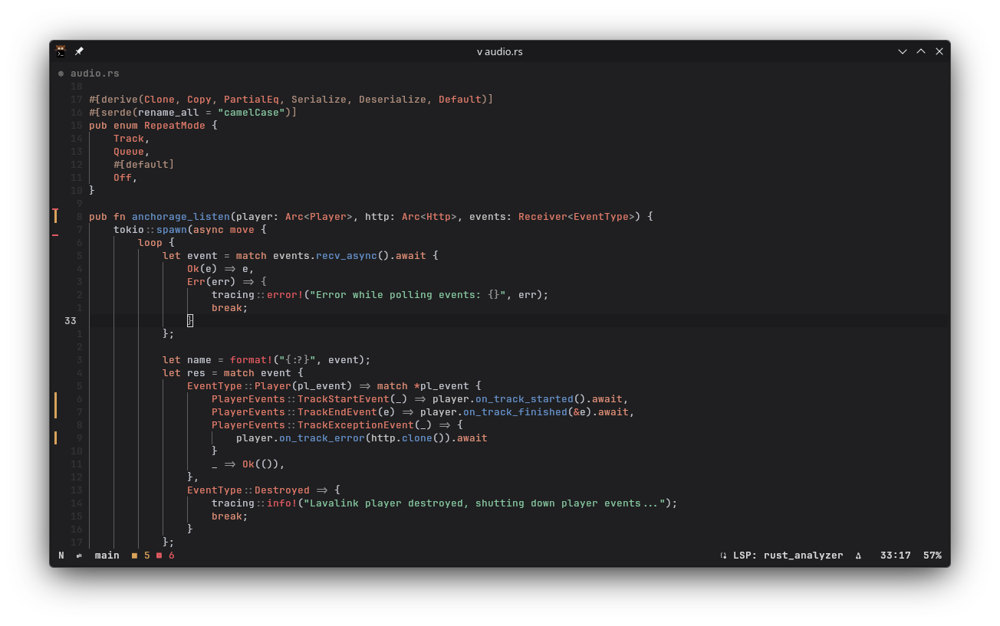
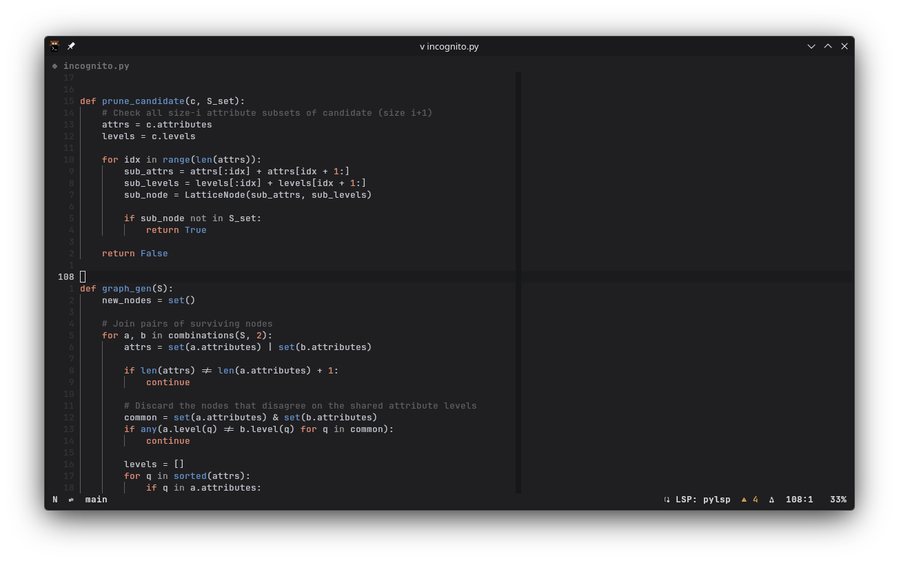
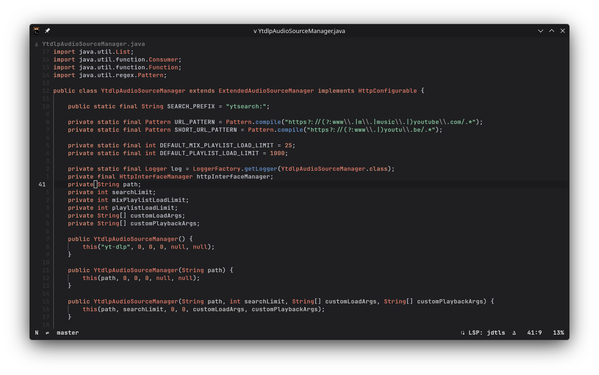
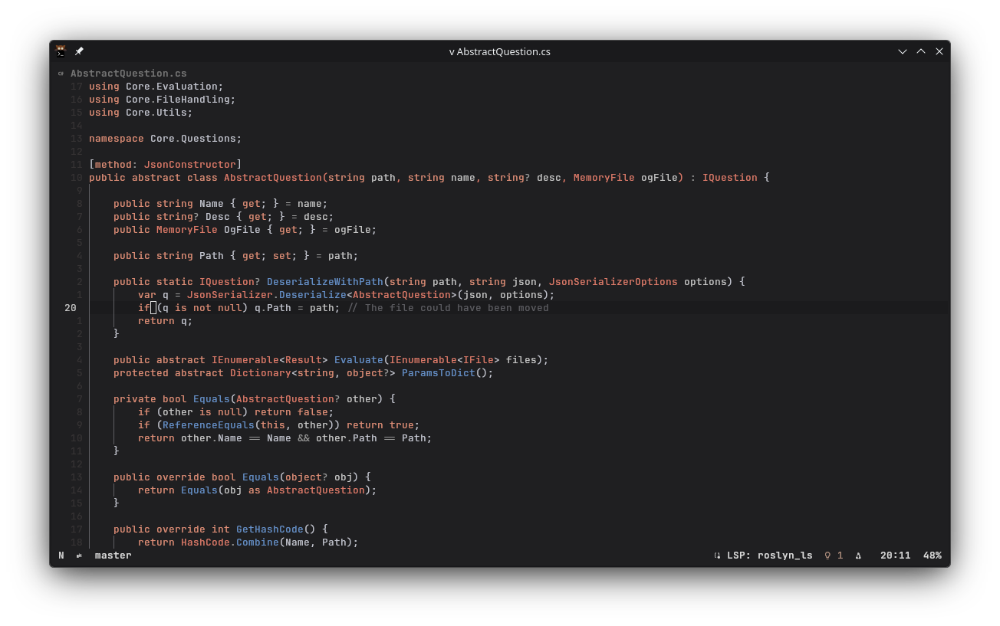
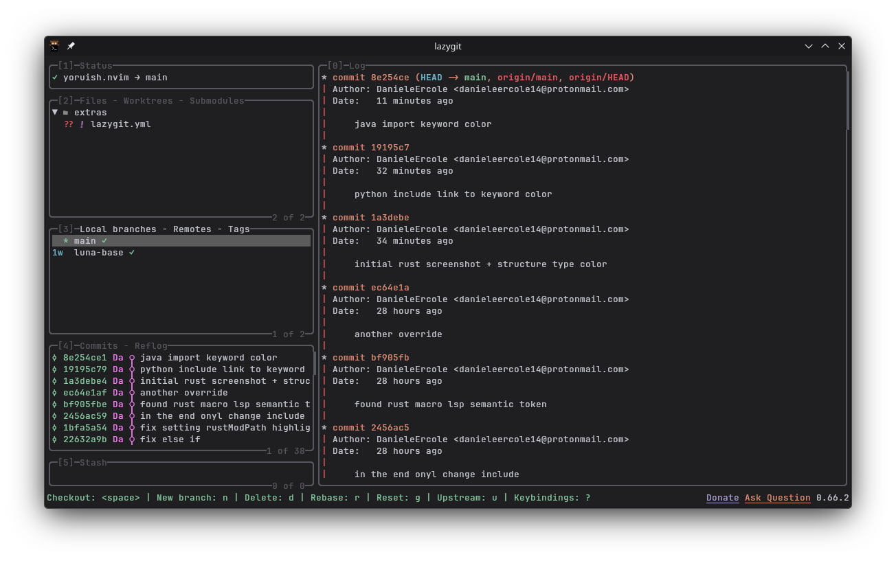
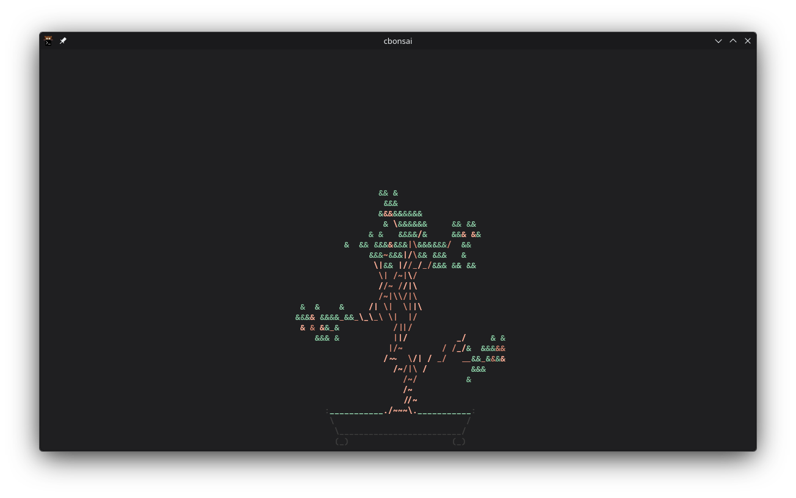

## Yoruish theme
The Neovim theme I currently use on my desktop, heavily inspired by the [theme used by @nferhat](https://github.com/nferhat/dotfiles/blob/main/theme/default.nix) and by the [Yoru](https://github.com/raexera/yoru) theme.

For the code structure, I used the [luna.nvim](https://github.com/WTFox/luna.nvim) theme's code, changing the palette colors and some groups

## Screenshots

**Rust**

**Python**

**Java**

**C#**

**Lazygit**

**kitty terminal**

